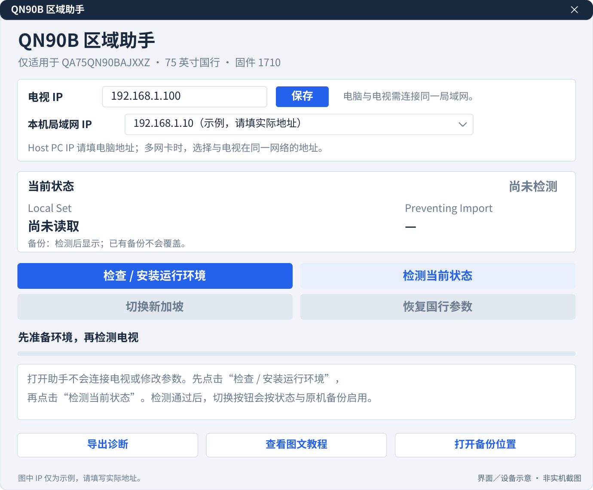

# Samsung TV Unlock Local Set

Samsung Tizen TV Local Set research and tools.

**面向所有地区、所有型号的 Samsung Tizen TV 开展理论适配研究；当前可直接使用的配置只有下面列出的 QN90B。** 不同设备能否适配，取决于开发者模式与 SDB、可用的 root 方法、工厂接口 ABI、参数映射以及可验证的恢复路径。理论研究范围不代表已经支持每台电视。

## 当前支持范围

| 项目 | 当前可直接使用的配置 |
| --- | --- |
| 电视 | **QA75QN90BAJXXZ**，75 英寸，国行 QN90B |
| 固件显示版本 | **1710** |
| 精确系统构建 | **T-PTMUABC-REL-202509042046** |
| 文件核验 | 四个工厂相关文件的 SHA256 必须全部匹配；见[兼容性说明](docs/COMPATIBILITY.md) |
| 电脑 | Windows 10 / 11 **x64（Intel / AMD）**，PowerShell 5.1；首次准备 OpenSSL 使用系统自带 `tar.exe`；不支持 ARM64 |
| 当前操作目标 | 切换为新加坡 `AD_SIN2`；凭真实原值备份恢复国行 `CHI_DTV` |
| 其他型号、尺寸、地区或固件 | **尚未验证**，不能直接套用本配置 |

即使另一台电视也叫 QN90B、显示 1710 或使用同一个 SW Model，也需要独立核验。程序保留型号、固件、文件指纹和实时参数检查，不能通过改型号名称或跳过检查来获得兼容性。

## 下载与使用

1. 打开 [Releases 下载页面](https://github.com/PaulWai0087/Samsung-TV-Unlock-Local-Set/releases/latest)，下载 **`Samsung-TV-Unlock-Local-Set-v1.0.2-Windows-x64.zip`**，右键选择“全部解压”。保留整个目录结构；完整源码也在包内。
2. 双击解压目录中的 **`START.cmd`**。首次点击“检查 / 安装运行环境”时需要联网：工具从配置的官方发行来源下载固定版本组件，并核对 SHA256。无需安装完整 Tizen Studio、Python 或 Git。
3. 按[Root 与开发者模式教程](docs/ROOT-GUIDE.md)准备电视，让电脑与电视处于同一局域网。填写电视 IP；电视上的 **Host PC IP 应填写电脑地址**。
4. 点击 **“检测当前状态”**。检测通过且按钮可用后，按需要点击“切换新加坡”或“恢复国行参数”。

首次准备环境会优先复用本机已有且可运行的 OpenSSL。没有可用版本时，会下载约 **124 MB** 的固定版 Git for Windows 官方归档，只提取所需 OpenSSL 文件，**无需安装 Git**；连同其他组件，首次下载约 **137 MB**。下载完成后会保留已核验缓存。需要系统内置 `tar.exe` 的现代 Windows 10 / 11；若提示缺失或不支持解压，请先更新 Windows 或安装官方 Git for Windows 后重试。

**如果已经显示“新加坡参数”，只需保留检测结果，无需重复切换。** 打开程序和准备电脑端环境不会修改电视工厂参数；切换按钮点击后会执行，并在写入前再次核对。

[Root 与开发者模式教程](docs/ROOT-GUIDE.md) · [离线图文教程](guide/index.html) · [10 页 PDF](guide/QN90B-Guide.pdf) · [兼容性与技术边界](docs/COMPATIBILITY.md)

## Root 怎样完成

助手在“检测当前状态”时会连接 SDB，并为地区参数读取建立临时 Root 会话，用户无需先安装永久 Root。环境准备完成、SDB 已连接和 Root 认证成功是不同状态。

新增的 [Root 教程](docs/ROOT-GUIDE.md)包含太阳能遥控器开启开发者模式、两个 IP 的填写位置、可复制的 PowerShell 验证命令，以及 `authenticated`、UID / EUID、命令退出码和清理结果的判读。手动验证仅运行 `id`；验证完成后，再由助手检测并按条件切换。临时会话结束不等于已写入的工厂参数会自动恢复。

*图为当前 QN90B 配置的界面示意，非 Windows 实机截图。*

## 状态与恢复

| 界面状态 | Local Set | Preventing Import | 含义 |
| --- | --- | --- | --- |
| 国行参数 | `CHI_DTV` | `13` | 本机记录的原始状态 |
| 地区列表已解锁 | `CHI_DTV` | `0` | 已完成第一阶段，可按检查结果继续 |
| 新加坡参数 | `AD_SIN2` | `0` | 已达到当前切换目标 |

恢复会使用原电脑、原 Windows 账户下的真实原值备份，先恢复 Local Set，再恢复 Preventing Import。请保留 `Original-Baseline.json`；它是这两项参数的回退依据，不是整机工厂数据镜像。缺少匹配备份时，程序不会编造原值。

当前仅开放上述新加坡目标和国行恢复路径。本机曾读到 55 个 Local Set 列表项，**这不表示 55 个地区都已验证或可由本工具切换**。修改区域参数也不保证应用商店、账户、授权或所有流媒体服务可用。

## 源码、验证与贡献

- [`app/`](app/)：Windows 界面、依赖准备和状态流程。
- [`source/`](source/)：两个阶段的 C# 辅助程序源码、接口核验说明与测试。
- [`engines/`](engines/)：对应的辅助程序、调用脚本与文件指纹。
- [`tests/`](tests/)：界面、流程和依赖逻辑的离线测试。
- [`tools/BUILDING.md`](tools/BUILDING.md)：固定 SDK 的源码构建与离线测试方法；普通用户无需编译。

已有实机证据与离线测试分开记录：Stage1 已核对实机结果 JSON；Stage2 有用户成功反馈；新图形封装经过离线检查，尚不代表已在所有 Windows 环境点测。详见[验证记录](VALIDATION.txt)。 Windows PowerShell 5.1 的实际自动检查结果见 [GitHub Actions](https://github.com/PaulWai0087/Samsung-TV-Unlock-Local-Set/actions/workflows/offline-validation.yml)。

其他设备欢迎提交[兼容性反馈](https://github.com/PaulWai0087/Samsung-TV-Unlock-Local-Set/issues/new?template=compatibility.yml)或按[贡献指南](CONTRIBUTING.md)补充只读证据。新增适配需要确认真实接口、参数映射、检查条件和恢复结果。**公开 Issue / PR 不要上传个人完整日志、原值备份、设备身份信息或三星固件二进制。**

## 许可与来源

本项目自有源码采用 [MIT License](LICENSE)。第三方工具、字体及其组件分别遵循各自许可；项目 MIT 许可不覆盖第三方内容。版本与来源见 [`THIRD-PARTY-NOTICES.txt`](THIRD-PARTY-NOTICES.txt)。

相关上游：[samsung-tv-root](https://github.com/chris-ritsen/samsung-tv-root)、[Samsung / Tizen 开发者资料](https://developer.samsung.com/smarttv/develop/getting-started/using-sdk/tv-device.html)、[Git for Windows](https://github.com/git-for-windows/git)。本项目是独立社区项目，与三星官方没有隶属关系。
