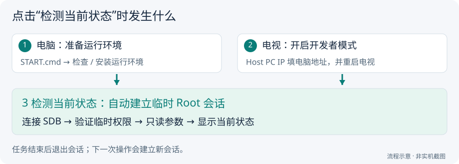
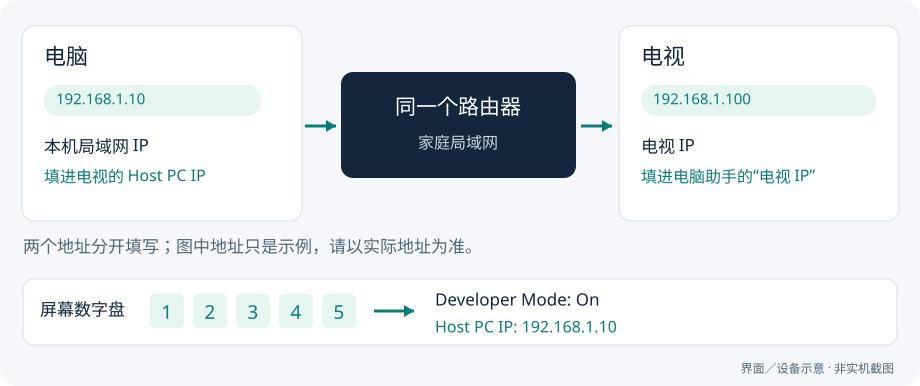
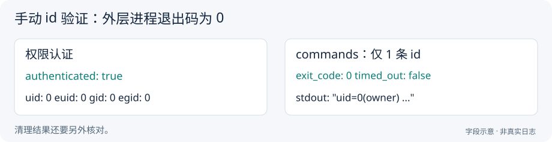

# QN90B 开发者模式与临时 Root 教程

本教程配合 **Samsung TV Unlock Local Set** 使用，说明如何连接电视、验证临时 Root，以及接着读取 Local Set。普通用户可以直接使用助手完成连接与临时权限处理；需要排查时，再按下方 PowerShell 步骤单独验证。

**当前依据来自 QA75QN90BAJXXZ（75 英寸国行 QN90B）、显示固件 1710、内部构建 `T-PTMUABC-REL-202509042046`。** 本机已有临时 Root 成功输出。其他型号、地区或固件的 Root 入口和工厂接口，需要另行核实；项目的理论研究范围见[兼容性说明](COMPATIBILITY.md)。

本文固定使用上游 [`samsung-tv-root v0.0.13`](https://github.com/chris-ritsen/samsung-tv-root/releases/tag/v0.0.13)、Samsung / Tizen SDB **4.2.36** 和本机已观察到的电视端 **.NET 3.1**。电脑要求为 Windows 10 / 11 x64，使用系统 Windows PowerShell 5.1。

## 1. 先分清三个状态

| 状态 | 你看见什么 | 它证明了什么 |
| --- | --- | --- |
| 开发者模式开启 | 电视 Developer Mode 为 On，并填写 Host PC IP | 已配置开发连接入口 |
| SDB 连接成功 | `sdb devices` 中有电视地址，状态为 `device` | 电脑可以通过 SDB 与电视通信 |
| 临时 Root 已验证 | 工具报告认证成功、数值 UID / EUID 为 0，且 Root 会话中的命令执行成功 | 本次会话确实取得了 Root 身份 |

`SDB port reachable`、`already connected`、`Ready: yes` 或工具退出码为 0，**单独出现都不足以证明 Root 成功**。完整判读见第 6 节。



## 2. 准备电视和电脑

### 2.1 下载完整项目并准备电脑环境

1. 在[仓库首页](https://github.com/PaulWai0087/Samsung-TV-Unlock-Local-Set)选择 **Code → Download ZIP**。
2. 右键 ZIP，选择“全部解压”。保留 `START.cmd`、`app`、`engines`、`guide` 等完整结构。
3. 双击 **`START.cmd`**，点击 **“检查 / 安装运行环境”**，等待“运行环境已就绪”。

这一步准备电脑上的 root 工具、SDB 和 OpenSSL，**不会修改电视工厂参数，也不代表电视已经 Root**。固定下载来源与 SHA256 记录在 [`app/Dependency-Manifest.json`](../app/Dependency-Manifest.json)。无需安装完整 Tizen Studio、Python 或 .NET 编译环境。

程序优先复用电脑上已有且可运行的 OpenSSL；没有可用版本时，会从固定的 Git for Windows 官方归档提取所需文件。首次全部下载约 137 MB，之后可复用已核验缓存。自动提取需要系统 `tar.exe`；旧系统缺失或不能解压时，请更新 Windows，或安装官方 Git for Windows 后重试。

### 2.2 两个 IP 地址要填对

让电脑和电视连接同一个家庭局域网，避免访客网络或设备隔离。电视用网线、电脑用 Wi-Fi 也可以，前提是双方可互相通信。

| 填写位置 | 应填写的地址 | 本文示例 |
| --- | --- | --- |
| 助手中的“电视 IP” | 电视的局域网地址 | `192.168.1.100` |
| 电视 Developer Mode 的“Host PC IP” | 运行工具的电脑地址 | `192.168.1.10` |

**示例地址不能原样照搬。** 助手显示的本机局域网地址应来自连接家庭路由器的网卡；多网卡时选择实际与电视相通的那一项。



## 3. 开启电视开发者模式

1. 在电视打开 **应用 / Apps**。部分布局需要进入 **应用设置 / App Settings**。
2. 输入数字 **1、2、3、4、5**，打开 Developer Mode 窗口。
3. 太阳能遥控器没有实体数字键时，用数字／彩色键（通常标为 **123**）调出屏幕数字盘，使用方向键和确认键输入。
4. 将 Developer Mode 设为 **On**，在 **Host PC IP** 填写电脑的局域网地址。
5. 确认并按电视提示重启，再打开 Apps 检查开发者模式。

以上连接步骤依据[三星开发者文档](https://developer.samsung.com/smarttv/develop/getting-started/using-sdk/tv-device.html)、[三星较早 Apps 界面示例](https://developer.samsung.com/tizen/blog/en/2019/07/16/connecting-smart-tv-and-visual-studio)及[官方遥控器数字盘说明](https://www.samsung.com/ae/support/tv-audio-video/navigate-your-samsung-tv-using-the-smart-remote-control/)。菜单布局可能随地区与固件变化；出现不同页面时，按实际界面核对。

## 4. 推荐：直接让助手检测

开发者模式和运行环境准备好后：

1. 在助手填写实际电视 IP，点击“保存”。
2. 点击 **“检测当前状态”**。
3. 等待工具连接 SDB、建立临时 Root 会话并执行地区参数读取。
4. 看到已验证的“国行参数”“地区列表已解锁”或“新加坡参数”后，按对应提示继续。

**助手已经包含临时 Root 流程，无需先安装永久 Root。** 检测读取地区参数；切换按钮另行执行工厂参数修改。当前状态已是“新加坡参数”时，可以保留结果，无需重复切换。

检测失败或想单独确认 Root 时，使用下一节。先结束助手中的任务并关闭窗口，避免同时运行多个连接／Root 流程。

## 5. 手动 PowerShell 验证

这一节只对本文列出的 QN90B 配置提供命令。它复用助手已经安装并校验的组件；最后一条命令**会实际尝试临时 Root**，然后仅执行 `id`，不调用 Local Set 或 Preventing Import 的写入接口。

### 5.1 在正确目录打开 PowerShell

进入已解压的项目文件夹，确认能看见 `START.cmd` 和 `app`。在资源管理器地址栏输入 `powershell` 并回车，打开 Windows PowerShell。

复制下面整段；把第一行示例 IP 改成电视的真实地址：

```powershell
$TvIp = '192.168.1.100'
$ErrorActionPreference = 'Stop'
$KitRoot = (Get-Location).Path

if (-not (Test-Path -LiteralPath (Join-Path $KitRoot 'START.cmd'))) {
    throw '请在项目解压后的根目录打开 PowerShell。'
}

# 仅对当前 PowerShell 窗口生效，关闭窗口后不保留此设置。
Set-ExecutionPolicy -Scope Process -ExecutionPolicy Bypass -Force
. (Join-Path $KitRoot 'app\Dependencies.ps1')
$Tools = Get-Qn90bTools -KitRoot $KitRoot

Test-NetConnection -ComputerName $TvIp -Port 26101
```

看到 `TcpTestSucceeded : True` 说明端口可达。若提示运行环境未就绪，回到助手完成“检查 / 安装运行环境”，然后重新打开这个 PowerShell 窗口。

### 5.2 连接 SDB 并核对电视

```powershell
& $Tools.Sdb connect "$($TvIp):26101"
if ($LASTEXITCODE -ne 0) { throw 'SDB 连接失败，请保留错误提示。' }

& $Tools.Sdb devices
if ($LASTEXITCODE -ne 0) { throw 'SDB 设备列表读取失败。' }
```

设备列表中应出现你填写的地址、`device` 状态和正确型号。本文目标型号为 **`QA75QN90BAJXXZ`**。没有该设备、型号不符或状态异常时，先解决连接问题，不继续下一步。

`already connected` 表示连接已经存在，不是报错，也不表示 Root 已成功。

### 5.3 检查组件与 QN90B 预检

```powershell
& $Tools.Root --sdb $Tools.Sdb doctor
if ($LASTEXITCODE -ne 0) { throw '本机组件检查异常。' }

& $Tools.Root --sdb $Tools.Sdb preflight qn90b $TvIp
if ($LASTEXITCODE -ne 0) { throw '电视预检没有正常完成。' }
```

请阅读输出：

- **`doctor` 的 `Ready: yes`** 说明本机工具和所需 payload 已就绪。该版本的 `doctor` 可能在未就绪时仍返回退出码 0，因此还必须检查 Ready 字段。
- **`preflight qn90b`** 用于采集本机与该配置的兼容性信息，尚未执行这里的 Root 验证命令。它输出文本，不要把 `--output json` 加上后就按 JSON 解析它。
- 本机此前显示 **`compatible-untested`**，同时报告已观察到的构建 `T-PTMUABC-REL-202509042046`；这是上游 profile 的已测试构建与本机不同所产生的状态，不等于已经取得 Root。后续实际 Root 认证输出才提供权限证据。
- 出现 `incompatible`、不认识的构建、运行时或关键能力缺失时，保留输出，停止照搬本例。不要改成其他机型 profile 或跳过检查。

`archive-root probe` 也会尝试 Root，**不能用它替代无 Root 的预检**。

### 5.4 建立临时 Root，会话中仅执行 `id`

仍在同一个 PowerShell 窗口运行：

```powershell
$EvidenceDirectory = Join-Path $env:LOCALAPPDATA 'QN90B-root\root-check'
[void][IO.Directory]::CreateDirectory($EvidenceDirectory)
$EvidenceBase = Join-Path $EvidenceDirectory ('Root-' + [Guid]::NewGuid().ToString('N'))
$EvidencePath = $EvidenceBase + '.json'
$RootErrorPath = $EvidenceBase + '.stderr.log'

# Windows PowerShell 5.1 下保留原生程序的 stderr，避免丢失具体错误。
$SavedErrorPreference = $ErrorActionPreference
$RootExitCode = $null
try {
    $ErrorActionPreference = 'Continue'
    $global:LASTEXITCODE = $null
    $RootOutput = & $Tools.Root --sdb $Tools.Sdb --output json archive-root root $TvIp --runtime 3.1 --command id --command-timeout 45 2> $RootErrorPath
    $RootExitCode = $LASTEXITCODE
} finally {
    $ErrorActionPreference = $SavedErrorPreference
}

$RootJson = $RootOutput -join [Environment]::NewLine
[IO.File]::WriteAllText($EvidencePath, $RootJson, (New-Object Text.UTF8Encoding($false)))

$RootJson
"Root tool exit code: $RootExitCode"
"Evidence saved to: $EvidencePath"
"Error log saved to: $RootErrorPath"
if (Test-Path -LiteralPath $RootErrorPath) {
    Get-Content -LiteralPath $RootErrorPath
}
```

这里的参数位置有意义：全局参数 `--sdb` 和 `--output` 放在 `archive-root` 前；`--runtime 3.1` 位于 `root` 子命令之后。

**`3.1` 指电视已有的 .NET 运行时**，不是要求你在 Windows 安装 .NET 3.1，也不会给电视安装这个运行时。本机先前自动检测到 3.1，因此本例显式使用该值。其他设备需要独立核实。

上述两份日志保存在电脑本地。若命令报错、没有生成可解析的 JSON，或工具退出码为空／非 0，先读取 `.stderr.log` 中的具体错误，不把保留日志这件事当成执行成功。

## 6. 怎样确认 Root 真正成功

以下示例是**手动仅执行一次 `id` 的关键字段示意**，不是完整日志，也不是所有设备的实测输出：

```json
{
  "authenticated": true,
  "uid": 0,
  "euid": 0,
  "gid": 0,
  "egid": 0,
  "commands": [
    {
      "command": "id",
      "exit_code": 0,
      "timed_out": false,
      "stdout": "uid=0(owner) gid=0(root) ..."
    }
  ],
  "staging_cleaned": true,
  "system_files_unchanged": true
}
```

| 检查项 | 应看到的结果 | 含义 |
| --- | --- | --- |
| 命令后的 `Root tool exit code` | `0` | 本机 root 工具正常完成 |
| `authenticated` | `true` | 会话认证成功 |
| `uid`、`euid`、`gid`、`egid` | 均为数值 `0` | 会话身份与上游认证要求一致 |
| `commands` | 恰有本次要求的 `id` | 确认验证的是这次命令 |
| `id` 的 `exit_code` / `timed_out` | `0` / `false` | 身份查询成功且未超时 |
| `id` 的标准输出 | 含 `uid=0(...)` | Root 会话中的命令也报告 UID 0 |
| `staging_cleaned` | `true` | 上游报告临时文件已清理 |
| `system_files_unchanged` | `true` | 上游检查的两项系统文件前后哈希一致 |

`system_files_unchanged` 在这个版本中检查的是 **`/etc/passwd` 和 `/usr/share/sdbd/public.pem`**，不能解读为“扫描了整台电视的全部文件”。如果身份已经确认，但清理字段异常，保留完整本地结果并排查清理问题，不把它描述成完整、干净的验证成功。



以下情况容易看错：

- **`uid=0(owner)` 可以是成功结果。** 判断数值 UID，括号中的用户名可能叫 `owner`，不必强求文字 `root`。
- **`model: null` / `model: none` 可以正常。** 这是通用 `archive-root` 路径，不需要把命令硬改成机型专用路径。目标电视仍需通过之前的 SDB 列表核对。
- **`smack: User` 不是单独的失败依据。** UID 0 与三星的其他访问控制是不同层次；临时 Root 也不保证所有文件、接口和功能都能任意访问。
- 这张表适用于上面这条手动 `id` 命令。助手“检测当前状态”执行的是组合读取命令，不能要求它的 `commands` 也必须是 `id`。

## 7. 验证成功后怎样继续换区

1. 保留这次 Root 结果，结束手动验证。
2. 重新打开 **`START.cmd`**，确认电视 IP。
3. 点击 **“检测当前状态”**，由助手建立本次操作所需的临时会话。
4. 型号、构建、四项固件指纹、当前参数及所需原值备份均核对通过后，再按[图文指南](../guide/index.html#singapore)切换。

**临时 Root 验证成功，不等于 Local Set 已经切换。** Root 会话结束后工具会退出并清理，不会因为执行 `id` 就安装开机常驻的 Root 服务。后续操作需要时会重新建立临时会话。

同样，临时权限结束也**不会自动恢复会话期间已写入的工厂参数**。地区恢复仍需真实原值备份，并使用助手的“恢复国行参数”流程。

## 8. 常见错误怎么处理

| 提示或现象 | 原因定位与下一步 |
| --- | --- |
| 下载返回 `403` | 先看失败 URL。若失败发生在 GitHub / Tizen 组件下载阶段，此时尚未执行 Root。确认电脑能访问该官方地址，重试“检查 / 安装运行环境”。 |
| `TcpTestSucceeded : False` | 核对电视开机、当前 IP、同一局域网、开发者模式和 Host PC IP；更改开发者设置后重启电视。 |
| SDB 列表没有电视 | 重新核对地址和开发者模式。端口可达本身不能替代 `sdb devices` 的设备状态。 |
| `already connected` | 已有 SDB 连接，可以继续核对设备列表。 |
| `doctor` 显示 `Ready: no` | 组件或 payload 缺失，先修复本机环境；不继续 Root。 |
| 预检等待回连或超时 | 核对开发者模式中的电脑 IP、实际网卡和家庭／专用网络的防火墙许可，不需要关闭整台电脑防火墙。 |
| 缺少 OpenSSL / 无法启动 | 重新运行环境准备；在当前 PowerShell 窗口通过 `Get-Qn90bTools` 重新取得组件和环境变量。 |
| `tar.exe` 缺失或无法读取 `.bz2` | 更新 Windows，或安装官方 Git for Windows 供工具复用 OpenSSL，再重试。 |
| `authenticated: false`、非 0 UID 或命令超时 | 本次没有完成完整的 Root 验证；保留错误和日志，不继续工厂参数修改。 |
| Root 成功，但助手报告工厂指纹不匹配 | 权限与型号适配是两件事。按[兼容性反馈模板](https://github.com/PaulWai0087/Samsung-TV-Unlock-Local-Set/issues/new?template=compatibility.yml)提交必要的脱敏信息。 |

公开反馈时只提交型号、构建、操作步骤和经过脱敏的必要错误片段。完整日志、原值备份、序列号、MAC、machine-id 和设备绑定信息保存在自己电脑，不直接贴到公开 Issue。

## 来源与验证范围

- [Samsung Developer：TV Device](https://developer.samsung.com/smarttv/develop/getting-started/using-sdk/tv-device.html)：开发者模式、Host PC IP 与设备连接。
- [samsung-tv-root v0.0.13 固定版本源码](https://github.com/chris-ritsen/samsung-tv-root/tree/v0.0.13)及[对应发行页](https://github.com/chris-ritsen/samsung-tv-root/releases/tag/v0.0.13)：命令结构、临时 Root 结果与清理字段。
- [项目组件清单](../app/Dependency-Manifest.json)：实际下载版本与指纹。
- [项目验证记录](../VALIDATION.txt)：本机 Root / Stage1 证据、用户 Stage2 反馈与离线测试的区别。

核对日期：2026-11-18。本教程依据固定版本实现与本机既有输出编写；新增教程没有再次连接电视或执行 Root，也不把其他设备列为已验证。
